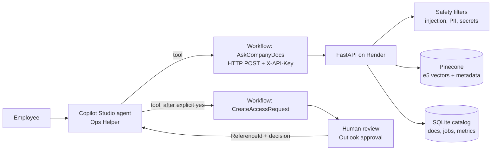

# Enterprise Process Automation & Copilot Assistant

The **Enterprise Process Automation & Copilot Assistant** is a portfolio project that helps employees find answers in approved process documents and request access through human approval. It connects the **Ops Helper** agent in Microsoft Copilot Studio to Power Automate workflows and a Python/FastAPI API deployed on Render, which retrieves from a Pinecone serverless index. All documents are synthetic.

**Stack:** Microsoft Copilot Studio, Power Automate, Python, FastAPI, Render, Pinecone serverless, and multilingual-e5-large embeddings (1024 dimensions, cosine metric).

## What it does

| Capability | How it works |
|---|---|
| Grounded answers | AskCompanyDocs calls the API, which retrieves approved passages and returns an answer with source citations. |
| Access boundaries | The API filters by server-side group permissions and re-checks retrieved records against its catalog. |
| Safe fallback | The API abstains when evidence is below calibrated `MIN_SCORE` and blocks the tested jailbreak case. |
| Access requests | CreateAccessRequest runs only after the user confirms a summary, then waits for human review in Outlook. |

## Architecture



Question path: question -> safety check -> query embedding -> Pinecone search with server-built filter (`allowed_groups`, `ACTIVE`, not flagged) -> catalog re-check -> `MIN_SCORE` threshold -> template -> cited answer.

Pinecone index: `ops-assistant`, 1024 dimensions, cosine metric. The API checks retrieved records against the SQLite catalog before returning them.

## Measured results

Pinecone figures below are from the run recorded in [docs/EVALUATION.md](docs/EVALUATION.md). The offline hash baseline is included for comparison.

| Measure | Offline hash baseline | Pinecone e5 |
|---|---:|---:|
| Hit@1 | 26/27 | 27/27 |
| Hit@3 | 27/27 | 27/27 |
| Abstention on unanswerable questions | 4/4 | 4/4 |
| Restricted-document access leakage | 0 | 0 |
| Safety cases | 5/5 | 5/5 |
| Calibration | — | Answerable min 0.834; unanswerable max 0.775; `MIN_SCORE` 0.80 |

The project has **27 passing automated tests**. End-to-end Copilot Studio checks passed for a cited answer (8 days casual leave, with a Leave Policy citation), cafeteria abstention, the Project Banyan access boundary, jailbreak blocking (`OpenAIJailBreak`), and an approved access request (`REQ-20261014-120744`). The evaluation set is small; see [limitations](#limitations).

## Screenshots

Coming soon.

## Run locally

The offline setup uses the in-memory vector store and hash embedder, so it does not require Pinecone credentials.

```powershell
python -m venv .venv
.venv\Scripts\Activate.ps1
pip install -r requirements.txt
python scripts/ingest.py
uvicorn app.main:app --reload --port 8000
```

Open `http://localhost:8000/` for the test console or `http://localhost:8000/docs` for the API. This uses the offline defaults. For the Pinecone-backed setup, follow [Pinecone setup](docs/03-pinecone.md); never put credentials in tracked files.

## Folder map

| Path | Contents |
|---|---|
| `app/` | FastAPI service, retrieval, safety, catalog, templates, and test console |
| `copilot/` | Ops Helper instructions, workflow/API artifacts, and sample responses |
| `docs/` | Architecture, setup, integrations, deployment, demo, and measured evaluation |
| `eval/` | Labelled evaluation questions |
| `powerautomate/` | Flow payload and expression examples |
| `sample_docs/` | Synthetic policy and process documents |
| `scripts/` | Ingestion and evaluation commands |
| `tests/` | Automated tests |
| `render.yaml` | Render service blueprint |

## Limitations

- The evaluation has only four unanswerable questions, all clearly off-topic. Near-miss questions could stress the abstention threshold more thoroughly.
- The evaluation set has 36 labelled questions; its results should not be generalized to broader or real-world corpora.
- Retrieval evaluation measures the correct document, not the correct section.
- The corpus contains nine synthetic documents; a real corpus would need permission integration and threshold re-calibration.
- API-key group mapping is a demo identity model, not per-user enterprise authentication.
- Render's free service can sleep, and its local disk is ephemeral. It is not an always-on production deployment.
- Prompt-safety checks are useful defense-in-depth, not a guarantee against every injection.

## Production upgrade path

Use Entra ID user tokens and group claims instead of shared API keys; sync document permissions from SharePoint; move the catalog to PostgreSQL and background work to a durable queue; store secrets in Key Vault; add monitoring, malware scanning, and OCR; and evaluate hybrid retrieval or reranking against a larger representative corpus. Keep human approval for access requests.

## Documentation

Start with [the documentation index](docs/00-README.md), then see the [project specification](PROJECT_SPECIFICATION.md), [design changes](DESIGN-CHANGES.md), [deployment notes](docs/06-deploy.md), and [evaluation details](docs/EVALUATION.md).
