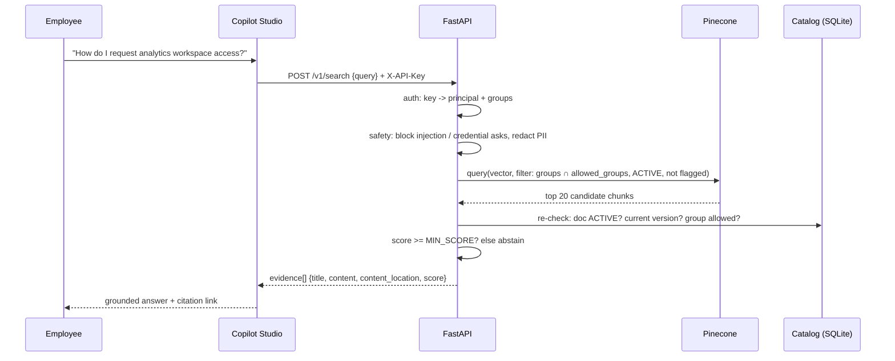
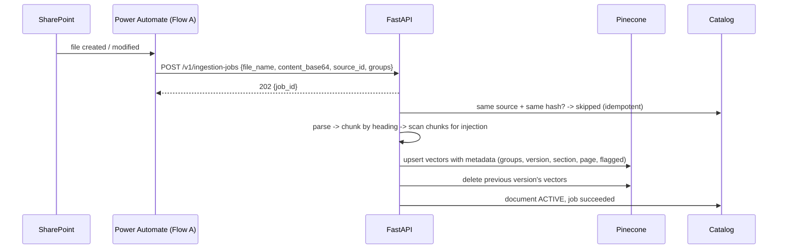

# 01 — Architecture and Design Decisions

## The one-line pitch

An authenticated employee assistant that answers operational questions **only** from approved internal documents, shows where each answer came from, refuses to guess, and runs routine actions through Power Automate only after the user confirms.

## Components and responsibilities

| Component | Owns | Does NOT own |
|---|---|---|
| **Copilot Studio agent** | Conversation, workflow calls, final wording, asking for confirmation | Document access rules, secrets |
| **Python FastAPI API** | Parsing, chunking, embeddings, Pinecone search, access filtering, safety filters, templates, logs | The chat UI |
| **Pinecone** | Fast similarity search over chunk vectors + metadata filters | Being the system of record |
| **SQLite catalog** | Which documents exist, their version, groups, status (ACTIVE/DELETED), jobs, metrics | Vector search |
| **Power Automate Flow A** | Sends new, changed or deleted SharePoint files to the API | Deciding who can read what |
| **Power Automate Flow B** | One named, allowlisted action: an access request with manager approval | Free-form "run anything" actions |

## Flow 1 — answering a question

## Flow 2 — ingesting a document

## Flow 3 — a confirmed action

Copilot Studio detects "raise an access request", collects resource, role, duration and justification, **shows a summary and asks Yes/No**, and only after "Yes" calls Flow B. Flow B validates the inputs, creates a request row, returns a reference number, then waits for manager approval.

## Key design decisions (be ready to defend each)

1. **The API returns evidence, Copilot writes the words.** The `/v1/search` endpoint does no text generation, so every claim can be traced to a passage. `/v1/answer` gives a template-built answer for simple channels and the test console.
2. **Access is enforced on the server, twice.** Groups come from the API key, never from the request body (the schema rejects extra fields). Pinecone gets a metadata filter, then the catalog re-checks every hit. If the two disagree, the catalog wins.
3. **Lifecycle gate.** Delete marks the document `DELETED` in the catalog *first* (instantly hidden), then removes vectors. A half-finished cleanup can never leak content.
4. **Abstain, don't guess.** If the best similarity is below `MIN_SCORE`, the answer is "not in the approved documents, contact the service desk". The threshold is calibrated on a labelled question set, not guessed.
5. **Documents are data, not instructions.** Chunks containing instruction-like text are flagged at ingestion and never returned. The agent instructions also say to ignore instructions inside documents.
6. **Idempotency.** `source_id + content hash` makes duplicate events harmless, and deterministic document IDs mean re-ingestion overwrites instead of duplicating.
7. **Privacy by default.** Query text is not stored; logs keep only intent, outcome, score and latency. PII in questions is redacted before embedding.
8. **One model per index.** The index dimension must match the embedding model; the code refuses to start on a mismatch.

## Chunking choice

Split at headings and blank lines, pack to about 180 words with 30 words of overlap, and keep the section heading with each chunk. Policies are written as titled sections, so a chunk = a section gives clean citations ("Leave Policy — Carry forward"). Sizes are settings (`CHUNK_WORDS`, `CHUNK_OVERLAP_WORDS`); tune them with the evaluation script.

## Embeddings

Default: Pinecone-hosted `multilingual-e5-large` (1024 dimensions, cosine). It needs no extra API key, and e5 distinguishes `passage` (documents) from `query` (questions). Alternatives: a local `all-MiniLM-L6-v2` (384 dimensions), or the offline `hash` embedder used only for tests.
